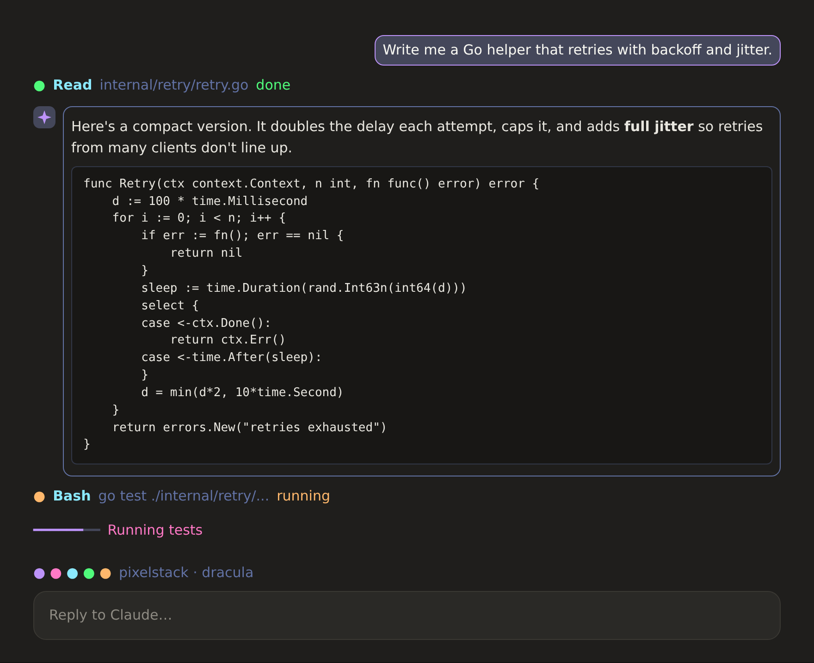
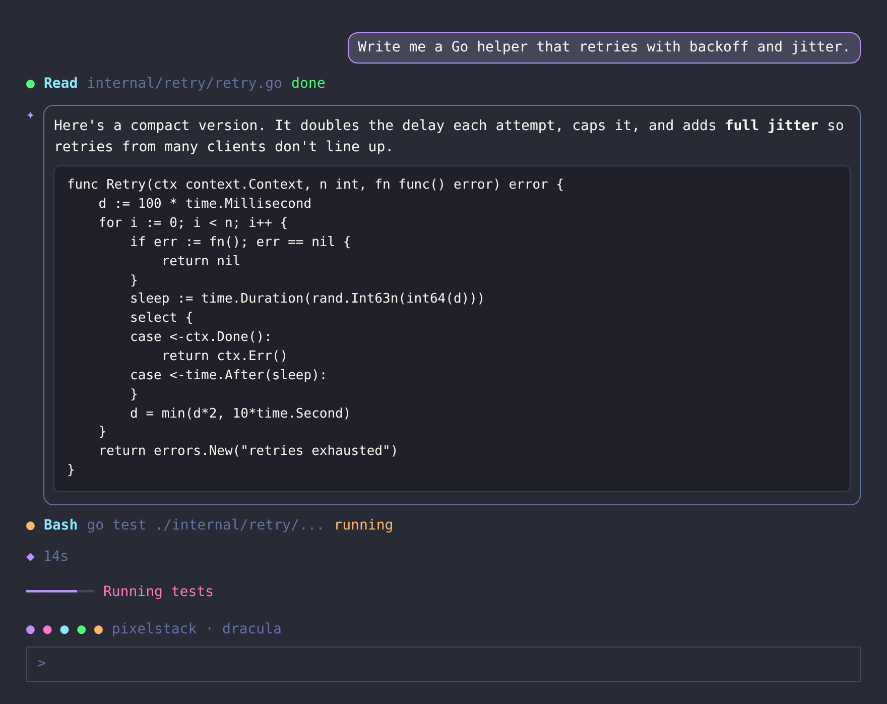
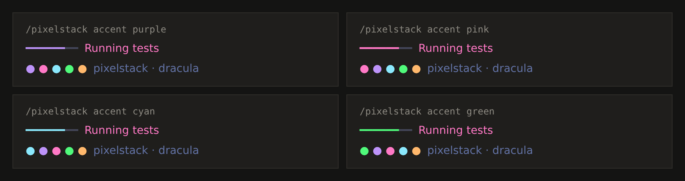

# Pixelstack

A Claude mod that redraws the conversation in the [Dracula](https://draculatheme.com) color scheme: purple, pink, cyan and green on a dark indigo-gray.



<details>
<summary>Terminal and accent colors</summary>





</details>

The Pixelstack elements in these images are drawn from the exact output of the mod's render hooks; the window, prompt box and fonts around them are a stand-in for the app (the terminal image assumes a Dracula terminal background). See [Regenerate the screenshots](#regenerate-the-screenshots).

## Install

At the prompt of a terminal session:

```
/plugin install pixelstack --marketplace rossedman/pixelstack
```

Answer `y` to add the marketplace, then pick a scope.

From a shell:

```sh
claude plugin install pixelstack --marketplace rossedman/pixelstack
```

In the desktop app: click + next to the prompt box, then Plugins, Add marketplace with `rossedman/pixelstack`, then Add plugin.

## What it changes

| Site | Drawing | Surfaces |
| --- | --- | --- |
| Your prompt | Current-line bubble with a rounded accent border, right-aligned | terminal, desktop, vscode |
| Claude's reply | Spark avatar + rounded comment-colored card around the reply | terminal, desktop, vscode |
| Tool calls | Status dot (orange running, green done, red error, gray stopped), tool in cyan, first argument in comment gray | terminal, desktop, vscode |
| Working line | Segmented progress line in the accent, label in pink | terminal, desktop, vscode |
| Turn footer | Accent diamond + duration | terminal |
| Above the prompt | Palette dots + "pixelstack · dracula" | terminal, desktop |

Expanded views (ctrl+o) always show the full default rows. The Claude mobile app runs the mod's commands but does not currently show its restyled rows. Pixelstack colors its own elements; for the full look, pair it with a Dracula theme for your terminal.

## Commands

- `/pixelstack on` / `/pixelstack off`
- `/pixelstack accent <purple|pink|cyan|green|orange|#hex>`
- `/pixelstack status`

Settings persist across sessions.

## Palette

From [Dracula](https://github.com/dracula/dracula-theme) (MIT).

| Token | Hex | Used for |
| --- | --- | --- |
| background | `#282A36` | terminal background (yours) |
| current line | `#44475A` | prompt bubble, empty progress |
| foreground | `#F8F8F2` | text |
| comment | `#6272A4` | reply card border, arguments, labels |
| purple | `#BD93F9` | default accent |
| pink | `#FF79C6` | working label |
| cyan | `#8BE9FD` | tool names |
| green | `#50FA7B` | done |
| orange | `#FFB86C` | running |
| red | `#FF5555` | error |

## Develop

```sh
claude plugin validate .
claude plugin test .
claude --plugin-dir .
```

`.claude-plugin/types/` is written by Claude Code when it loads the mod and is git-ignored.

### Regenerate the screenshots

`scripts/dump.test.tsx` prints every tree the mod draws for a sample conversation, and `scripts/screenshots.py` renders them in headless Chromium:

```sh
claude plugin test . > test-output.txt
pip install playwright markdown && python3 -m playwright install chromium
python3 scripts/screenshots.py test-output.txt docs
```

## License

MIT
