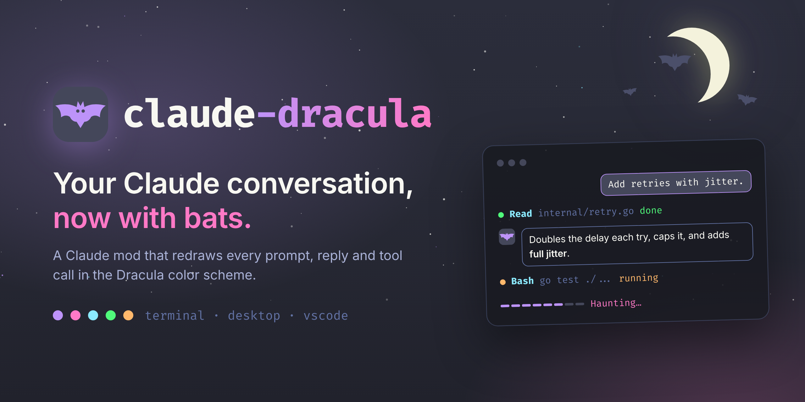

<p align="center"><a href="https://rossedman.github.io/claude-dracula/"></a></p>

# claude-dracula

**[rossedman.github.io/claude-dracula](https://rossedman.github.io/claude-dracula/)**

A Claude mod that redraws the conversation in the [Dracula](https://draculatheme.com) color scheme: purple, pink, cyan and green on a dark indigo-gray.


<details>
<summary>Terminal and accent colors</summary>


</details>

The claude-dracula elements in these images are drawn from the exact output of the mod's render hooks; the window, prompt box and fonts around them are a stand-in for the app (the terminal image assumes a Dracula terminal background). See [Regenerate the screenshots](#regenerate-the-screenshots).

## Install

At the prompt of a terminal session:

```
/plugin install dracula --marketplace rossedman/claude-dracula
```

Answer `y` to add the marketplace, then pick a scope.

From a shell:

```sh
claude plugin install dracula --marketplace rossedman/claude-dracula
```

In the desktop app: click + next to the prompt box, then Plugins, Add marketplace with `rossedman/claude-dracula`, then Add plugin.

## What it changes

| Site | Drawing | Surfaces |
| --- | --- | --- |
| Your prompt | Current-line bubble with a rounded accent border, right-aligned | terminal, desktop, vscode |
| Claude's reply | Bat avatar (spark with spooky off) + a raised rounded card (a moon-marked header on desktop); the markdown inside in Dracula colors (purple headings, orange bold, yellow italic, green code, cyan links and list markers, box-drawn tables) with Dracula syntax colors in code blocks | terminal, desktop, vscode |
| Tool calls | Status dot (orange running, green done, red error, gray stopped), the tool in its own color, first argument in comment gray; shell commands as a pink `$` and the command in yellow | terminal, desktop, vscode |
| Tool results | Hung from a gutter mark: Edit/Write as a Dracula diff (counts, numbered lines, tinted adds and removes), Bash as a terminal card, Read as one line, Grep/Glob as cyan hits; errors and other tools keep the usual result, the mark red on errors | terminal, desktop, vscode |
| Folded tool runs | One row of tool chips, like `Read ×3` `Grep` | terminal, desktop, vscode |
| Working line | A track that fills as the turn moves along, a bat flying over it; pink label like "Lurking…" or "Haunting…" | terminal, desktop, vscode |
| Turn footer | Accent diamond + "Fed for 14s" | terminal |
| Sound (`/dracula sound on`) | Organ sting at the end of a turn, a low toll when a tool errors, a wing flap when a long shell command finishes, a rising arpeggio for an approved plan | macOS |
| Above the prompt | Palette dots, the theme, the git branch, the session's tool count and failures, the moon's phase and the hour ("the witching hour") | terminal, desktop |
| Prompt footer | Mode labels as accent pills; the hint in comment gray (desktop) | terminal, desktop |
| Crypt pane (`/dracula crypt`) | Tools run as bars in each tool's color, files touched with their added and removed lines | terminal, desktop, vscode |
| Persona (`/dracula persona on`) | A faint gothic voice in Claude's replies, kept out of code and anything serious | all |

Expanded views (ctrl+o) always show the full default rows. The Claude mobile app runs the mod's commands but does not currently show its restyled rows. claude-dracula colors its own elements; for the full look, pair it with a Dracula theme for your terminal.

## Commands

- `/dracula on` / `/dracula off`
- `/dracula accent <purple|pink|cyan|green|orange|#hex>`
- `/dracula dark` / `light`: Dracula, or its light sibling [Alucard](https://draculatheme.com/spec) for light terminals and light mode (presets follow the theme)
- `/dracula spooky on` / `off`: the bat avatar, vampire words and the hour's name (on by default)
- `/dracula sound on` / `off`: the organ sting and the tool cues (off by default; plays a preview when turned on; macOS only)
- `/dracula persona on` / `off`: a faint gothic voice (off by default)
- `/dracula crypt`: opens the crypt pane
- `/dracula status`

Settings persist across sessions. The bat and moon icons and the sounds in `sounds/` (synthesized for this project; `python3 scripts/sounds.py` rebuilds the cues) are original.

## Palette

From [Dracula](https://github.com/dracula/dracula-theme) (MIT).

| Token | Hex | Used for |
| --- | --- | --- |
| background | `#282A36` | terminal background (yours) |
| current line | `#44475A` | prompt bubble, empty progress |
| foreground | `#F8F8F2` | text |
| comment | `#6272A4` | reply card border, arguments, labels |
| purple | `#BD93F9` | default accent |
| pink | `#FF79C6` | working label |
| cyan | `#8BE9FD` | tool names |
| green | `#50FA7B` | done |
| orange | `#FFB86C` | running |
| red | `#FF5555` | error |

## Develop

```sh
claude plugin validate .
claude plugin test .
claude --plugin-dir .
```

`.claude-plugin/types/` is written by Claude Code when it loads the mod and is git-ignored.

### Regenerate the banner

`scripts/banner.html` is the banner's source. `scripts/banner.py` renders it to `docs/banner.png` and `docs/social-preview.png` (1280×640, for the repository's social preview):

```sh
pip install playwright && python3 -m playwright install chromium
python3 scripts/banner.py docs
```

### The site

`docs/index.html` is the GitHub Pages site, a single self-contained page. Serve it from the `main` branch's `/docs` folder.

### Regenerate the screenshots

`scripts/dump.test.tsx` prints every tree the mod draws for a sample conversation, and `scripts/screenshots.py` renders them in headless Chromium:

```sh
claude plugin test . > test-output.txt
pip install playwright markdown && python3 -m playwright install chromium
python3 scripts/screenshots.py test-output.txt docs
```

## License

MIT
